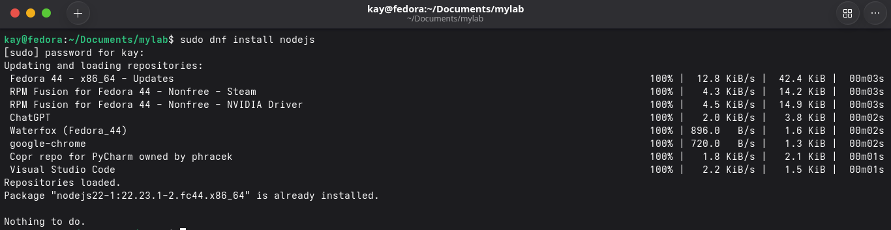
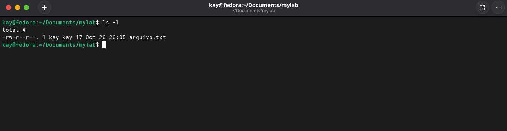
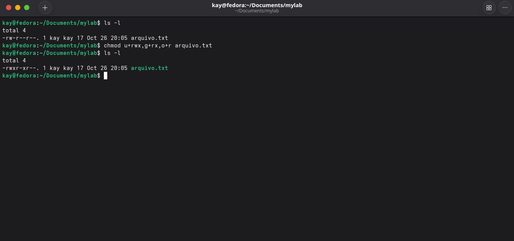
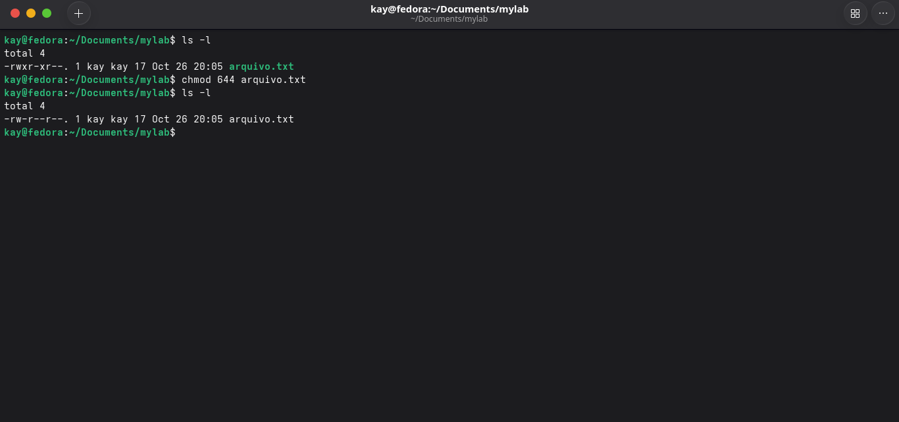
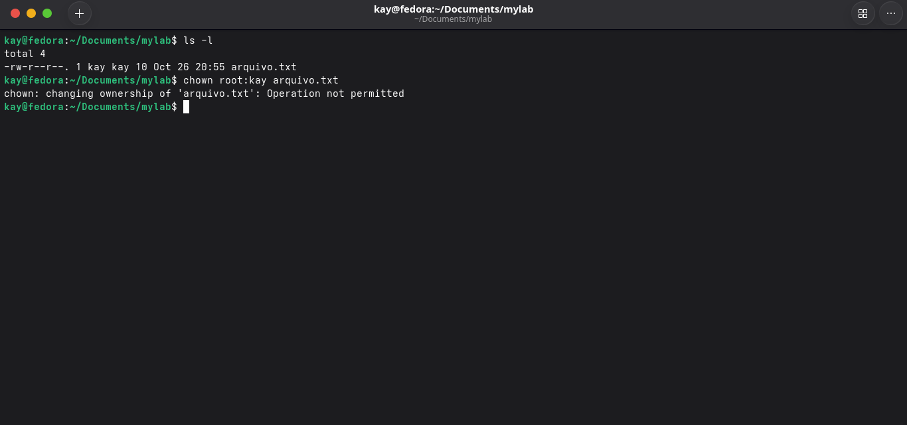
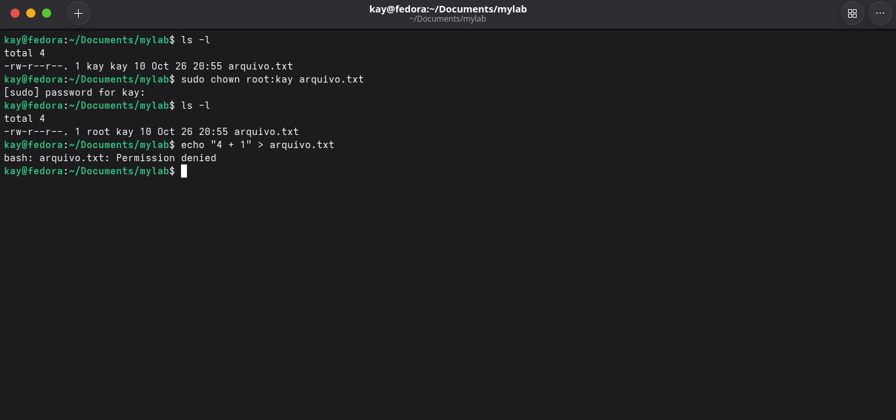
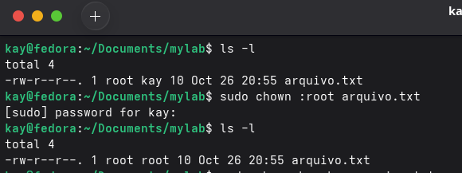

# Permissões e Admin

### `sudo`
- **sudo é um comando que pode ser utilizado para executar comandos com privilégios administrativos**

Útil para situações que exigem privilégios mais altos como para instalação de aplicativos ou até mesmo alterar arquivos do sistema.

Exemplo:

(Depende da distro que está utilizando, neste exemplo usei fedora)
-> `sudo dnf install nodejs`

### `chmod`
- **Com o chmod(Change Mode), você pode alterar e revogar permissões de arquivos e diretórios no Linux. As permissões em si controlam o que cada tipo de usuário(dono, grupo e outros) podem fazer com determinado arquivo ou diretório, sendo ler, escrever ou executá-lo**

No linux, cada arquivo ou diretório tem três tipos de permissões para as três categorias de usuário que são

1. Usuário(Owner): Proprietário do arquivo

2. Grupo(group): Grupo de usuários que aquele arquivo pertence

3. Outros(Others): Todos os outros usuários

- As permissões são representadas por três letras

r: Permissão para Ler(Read)

w: Permissão para Escrever(Write)

x: Permissão para Executar(Execute)

- Utilizando do comando anterior "ls -l" podemos verificar as permissões do arquivo

- O comando chmod pode ser utilizado de duas formas principais: usando a notação simbólica ou a notação numérica, vamos exemplificar os dois exemplos abaixo.

## 1. Notação Simbólica

A notação simbólica utiliza das letras para representar as permissões:

- u: Usuário(owner)

- g: Grupo

- o: Outros

- a: Todos(user, group, others)

Exemplo:

## 2. Notação Numérica 

Na notação numérica, cada permissão são representada por um número

- r = 4

- w = 2

- x = 1

4+2+1 <- Todas as permissões

Exemplo:

### `chown`
**chown -> change owner(Mudar dono) é exatamente como seu significado vem a dizer, com o chown podemos alterar o dono ou o grupo do arquivo ou diretório**

- Sua sintaxe se dá por esse formato:

`chown [opções] dono[:grupo] alvo`

Exemplo abaixo:

Como pode observar, utilizei o chown de forma errada para demonstrar que é necessário utilizar esse comando em privilégios elevados, por isso devemos utilizar o sudo no início de' nosso comando!

Na imagem mostro como a alteração dos proprietários funciona, após ser definido que apenas o root pode fazer alterações na pasta, o user acaba tendo sua permissão negada quando tenta fazer alterações no arquivo, até mesmo porque sua permissão está definida apenas como `read`.

É possível também singularmente alterar apenas o grupo, colocando um `:` antes do grupo.

