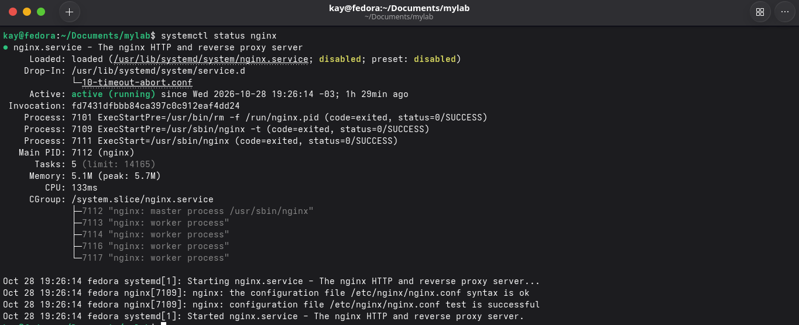
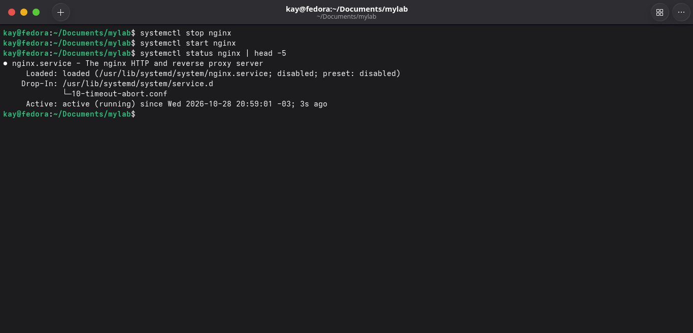
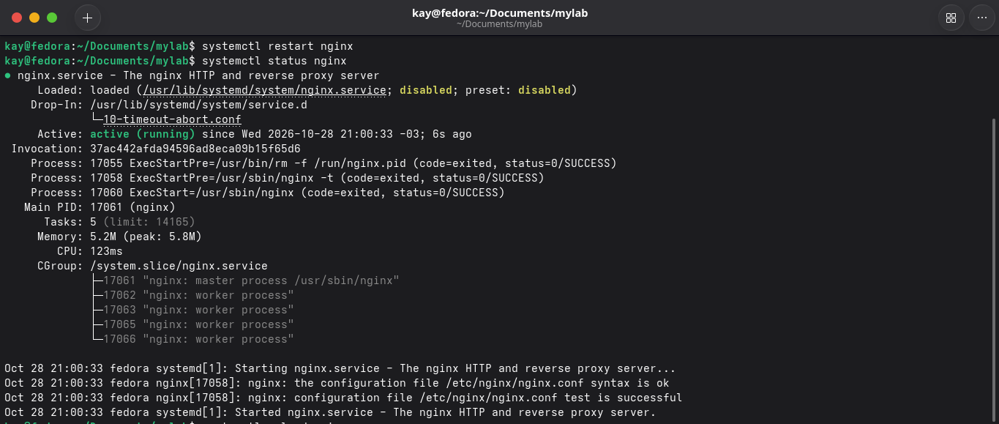
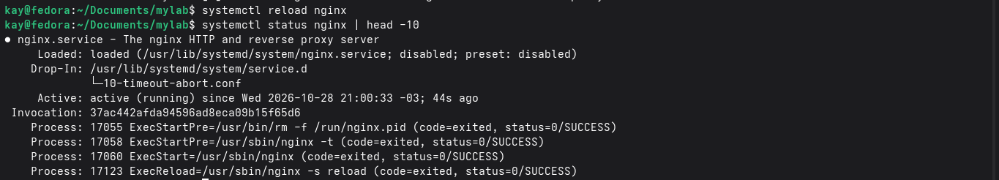
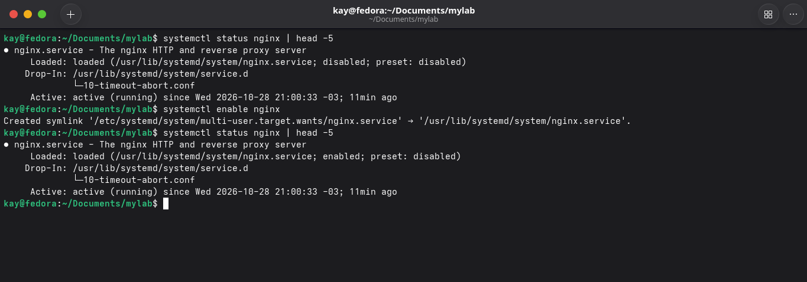
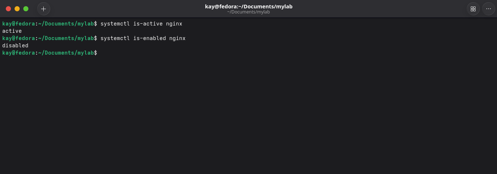
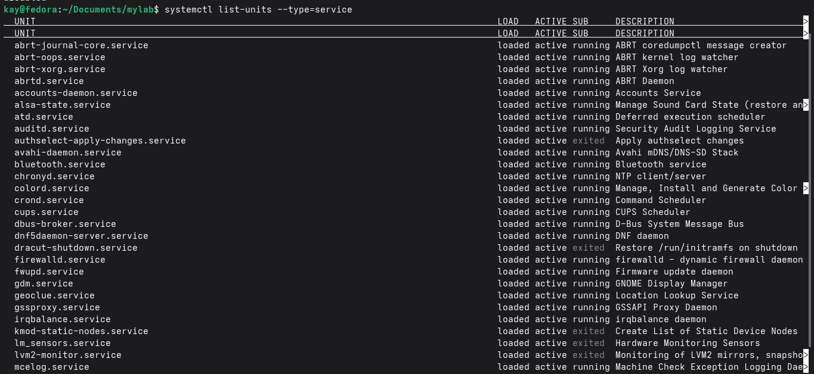
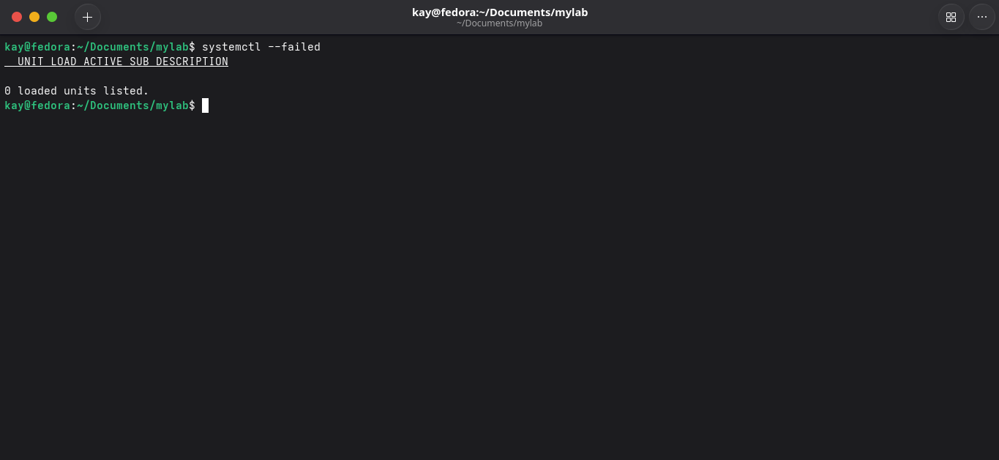

# Processos

### `ps aux`

De forma simples o ps aux atua como um gerenciador de tarefas(como no windows) mostra os processos que estão em execução no momento de execução do comando. É um htop porém em versão congelada

`ps` significa process status. O `aux` são três opções juntas que se completam:
- `a`: processos de todos os usuários
- `u`: formato detalhado (root, CPU e memória)
- `x`: inclui processos sem terminal (serviços em segundo plano)

Principais que podemos ver **USER** (dono), **PID** (número do processo), **%CPU**, **%MEM**, **COMMAND** (geralmente o programa).

Podemos filtrar alguns processos específicos utilizando o grep, como no exemplo abaixo:

`ps aux | grep /usr/bin/waterfox`

### `htop`

O htop funciona como um gerenciador de tarefas para o Linux, ele lista os processos em execução. Ao contrário do ps aux, ele mostra os processos de forma interativa, permitindo ordenar, filtrar e encerrar processos

### `kill`

kill é um comando que de forma simples encerra processos.

- Sua sintaxe se dá por esse formato:

`kill PID`

PID <- é o número do processo, quando se utiliza o `ps aux` geralmente o PID é o número da segunda coluna.

Criando um processo inofensivo podemos praticar o uso do kill

É possível criar um processo inofensivo com o comando `sleep 300 &`, e matar o processo filtrando ele com ps aux e por fim utilizando o comando kill.

### `systemctl status`

O systemctl é um dos principais comandos para gerenciar serviços, unidades e alvos do systemd.

## O que é o systemd?
- O systemd atua como o iniciador do sistema e também a infraestrutra dele. É o processo que inia logo após o kernel, ele é responsável por iniciar os serviços, montar o sistema de arquivos entre outras funções!

Dentro do ecossistema systemd, o **systemctl** atua como um gerenciador das atividades tais como:

- Iniciar, parar, reiniciar ou recarregar serviços.
- Ativar ou desativar unidades para que eles inicializem com o sistema
- Verificar o status dos serviços.

Suas principais sintaxes seriam estas:

## Ver o estado
- `systemctl status nginx`

## Ligar e Desligar
- `systemctl start nginx`
- `systemctl stop nginx`

## Reiniciar (Derruba a conexão)
- `systemctl restart nginx`

## Reler(Sem derrubar as conexões)
- `systemctl reload nginx`

## Iniciar ou não no boot
- `systemctl enable nginx`
- `systemctl disable nginx`

## Comandos rápidos com systemctl
- `systemctl is-active nginx`
- `systemctl is-enabled nginx`

## Para ter uma visão geral
- `systemctl list-units --type=service`

- `systemctl --failed`

Utilizei do serviço **nginx** como exemplo para o teste prático systemctl!
