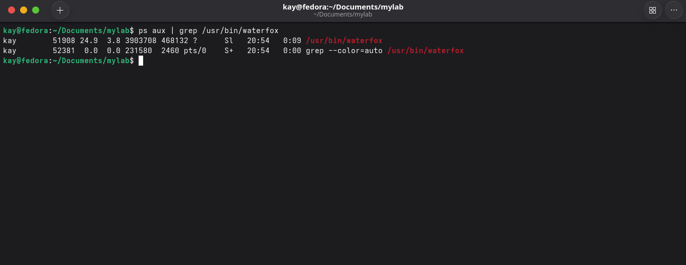
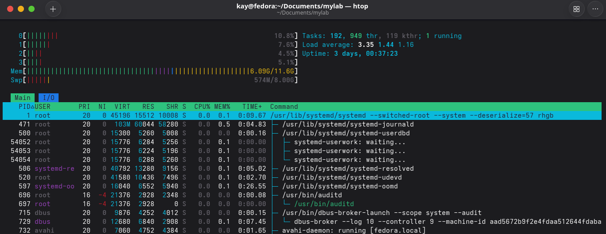
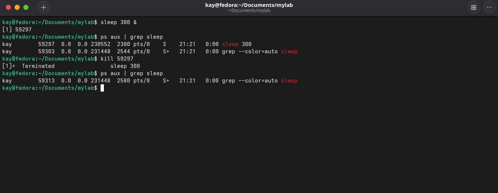

# Processos

### `ps aux`

De forma simples o ps aux atua como um gerenciador de tarefas(como no windows) mostra os processos que estão em execução no momento de execução do comando. É um htop porém em versão congelada

`ps` significa process status. O `aux` são três opções juntas que se completam:
- `a`: processos de todos os usuários
- `u`: formato detalhado (root, CPU e memória)
- `x`: inclui processos sem terminal (serviços em segundo plano)

Principais que podemos ver **USER** (dono), **PID** (número do processo), **%CPU**, **%MEM**, **COMMAND** (geralmente o programa).

Podemos filtrar alguns processos específicos utilizando o grep, como no exemplo abaixo:

`ps aux | grep /usr/bin/waterfox`

### `htop`

O htop funciona como um gerenciador de tarefas para o Linux, ele lista os processos em execução. Ao contrário do ps aux, ele mostra os processos de forma interativa, permitindo ordenar, filtrar e encerrar processos

### `kill`

kill é um comando que de forma simples encerra processos.

- Sua sintaxe se dá por esse formato:

`kill PID`

PID <- é o número do processo, quando se utiliza o `ps aux` geralmente o PID é o número da segunda coluna.

Criando um processo inofensivo podemos praticar o uso do kill

É possível criar um processo inofensivo com o comando `sleep 300 &`, e matar o processo filtrando ele com ps aux e por fim utilizando o comando kill.

### `systemctl status`