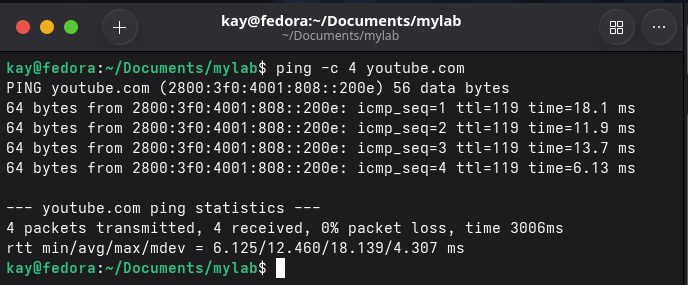
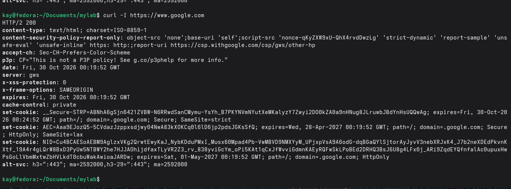
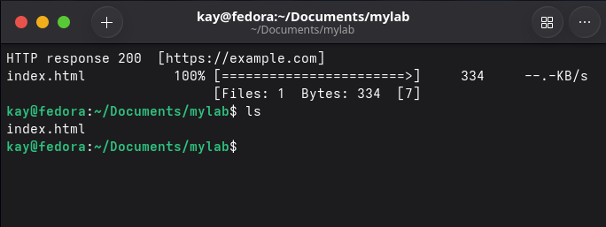
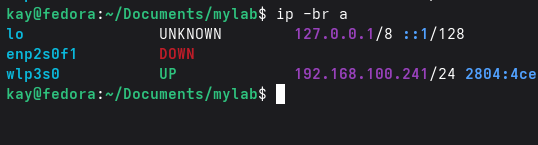
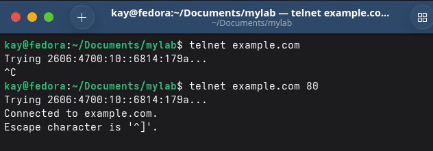
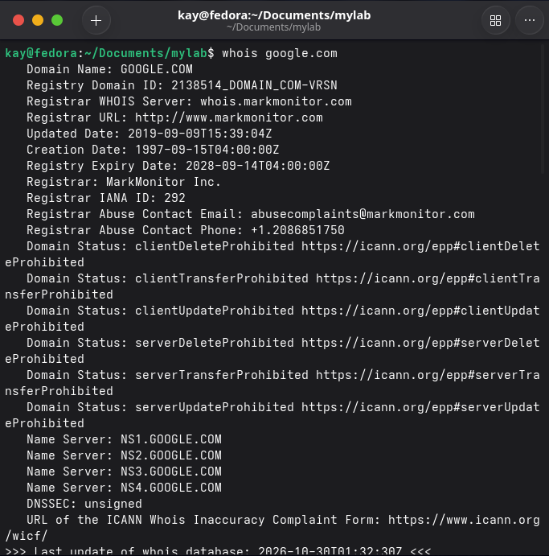
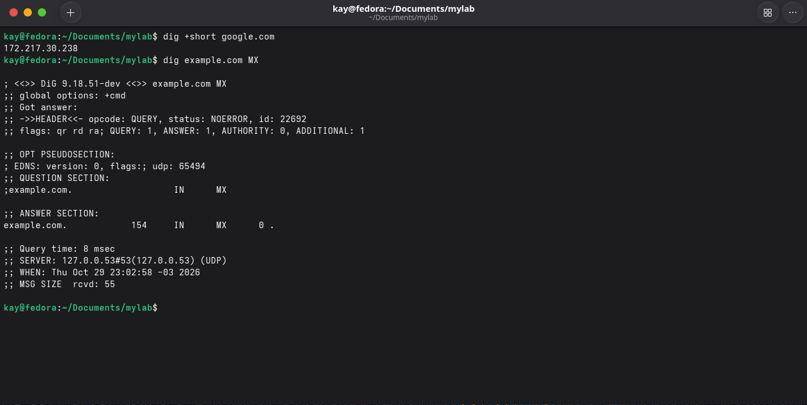

# Redes

## `ping`

O ping é basicamente uma ferramenta que verifica se o host está disponível e também mede o tempo de resposta
- Sua sintaxe é básica, desta forma:

`ping youtube.com`

É importante colocar uma contagem de quantos pacotes o ping deve enviar, pois se utilizarmos o ping sem definir um limite, ele ficaria rodando eternamente no terminal até você apertar Ctrl+C.
- Para colocar uma contagem, pode utilizar o comando com esse adicional `ping -c 4`

Algumas informações referente a saída do comando
- packet loss: 0% significa que não teve perda de pacotes.
- min/avg/max: melhor, média e pior tempo.
- mdev: mede a variação do RTT, quanto menor mais estável seria.
- icmp_seq: número do pacote
- ttl: limite de saltos restantes, pois ele limita quantos roteadores o pacote pode atravessar, para evitar loops.
- time: o RTT daquele pacote

### O que é RTT?
- O RTT é o tempo de ir ao destino e voltar

Em síntese, o ping é um comando ótimo para testar conexões, se estão acessíveis, verificar se há variação e lentidão em processos de rede!

## `curl`

Este é um comando que diferentemente do ping, faz requisições http/https e testa se o serviço está funcionando.
- É um comando que em si tem mais sintaxes para uso, porém a que eu trouxe foi a mais básica conforme o exemplo abaixo

O que se observar na imagem:
### Status HTTP
- A primeira coisa a se observar de importante é o status daquela conexão, temos as seguintes classes HTTP:

Classe Significado	      Tese
1xx	-  Informativo	    - “Cliente deve continuar”
2xx	-  Sucesso	        - “Tudo certo"
3xx	-  Redirecionamento	- “Procure em outro lugar, endereçamento errado talvez!”
4xx	-  Erro do cliente	- “O erro está no pedido do cliente”
5xx	-  Erro do servidor	- “O erro está no servidor”

## `wget`

O wget é como se fosse um gerenciador de downloads para o linux, ele baixa arquivos através de por via servidores HTTPS, HTTP e FTP
- No exemplo abaixo demonstro um uso simples desse comando.

Pode-se ver que o resultado **200** demonstra "sucesso", e logo após utilizar o `ls` o arquivo baixado estará presente na pasta.

## `ip a`

O ip é um comando que mostra as interfaces de rede e os IPs da máquina. É o primeiro comando para saber se o usuário está conectado e qual é o endereço de IP do usuário.

- Utilizei uma versão simples para reduzir as informações sensíveis, entretanto você pode testar o comando em seu terminal!

## `telnet`

telnet é um comando que testa portas abertas em um servidor!

- Sua sintaxe é básica, desta forma:

`telnet domínio-exemplo.com 80 <- porta`

Assim é possível testar se a porta do domínio em específico está aberta!

## `whois`

O comando whois consulta quem é o dono de um domínio ou de um bloco de IP.

`whois google.com`
`whois 163.250.0.0`

## `dig`

## `dig`

O `dig` consulta servidores DNS e mostra quais registros existem para um
nome, como o IP (A), os servidores de e-mail (MX) e os servidores de nome (NS).

Complementa o `whois`: o `dig` mostra **para onde o nome aponta**, e o
`whois` mostra **quem é o dono**.

​`dig +short example.com​`

Principais comandos

`dig +short google.com` <- IP do domínio
`dig example.com MX` <- servidores de e-mail
`dig example.com NS` <- servidores de nome
`dig -x 8.8.8.8` <- DNS reverso: Retorna o IP para nome.

