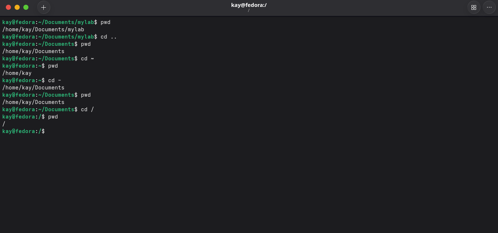
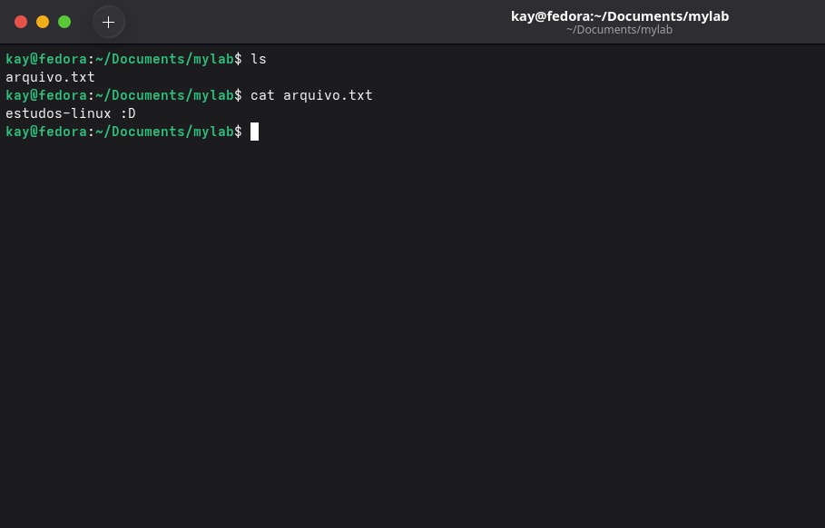

# Comandos de Navegação

### `pwd`

- **O comando `pwd` pode ser utilizado para mostrar o caminho da pasta atual.**

Exemplo: `pwd` → resultado → `/home/user/downloads`

O comando `pwd` é útil para confirmar em qual pasta o usuário está antes de executar outros comandos.

### `ls -la`

- **Esta é uma extensão detalhada do comando padrão `ls`.**

O comando `ls -la` traz essas informações: `permissões / links / usuário / grupos / tamanho do arquivo / data e hora / nome do arquivo`

O `l` lista os arquivos com detalhes, mostrando permissões, links, usuário, grupo, tamanho e data. O `a` exibe até os arquivos e diretórios ocultos do sistema. Combinados, a saída fica assim:

`drwxr-xr-x. 1 user user 38 oct 24 10:33 Desktop` ← arquivo não oculto

`drwxr-xr-x. 1 user user 442 oct 24 14:39 .config` ← arquivo oculto, definido geralmente pelo `.` no início do nome

### `cd`

- **`cd` é um comando básico de navegação entre pastas.**

Pode ser utilizado da seguinte forma: o usuário quer ir até a pasta Downloads, usa `ls` para listar os diretórios disponíveis → `Desktop, Downloads, Documents...` → então executa `cd Downloads` → e logo após usa `pwd` para confirmar: `/home/user/Downloads`.

Há também outras formas básicas de navegação:

- `cd ..` ← sobe um nível para a pasta pai → de `/home/user/Downloads` vai para `/home/user`
- `cd ~` ← vai para a pasta pessoal (home) → de qualquer lugar vai para `/home/user`
- `cd -` ← volta para a pasta onde estava antes → alterna entre as duas últimas pastas
- `cd /` ← vai para a raiz do sistema → destino `/`

### `mkdir`

- **`mkdir` (make directory) é o comando utilizado para criar diretórios.**

Exemplos de uso:

Pode-se criar pastas através de um caminho específico → `mkdir /home/user/Documents/estudos-linux`, ou diretamente dentro da pasta atual → `mkdir estudos-linux`

O resultado é a criação da pasta desejada. Liste com `ls` para confirmar → `ls` → `estudos-linux`

### `cp`

- **`cp` (copy) é o comando utilizado para copiar arquivos e pastas.**

Formato:

`cp origem destino`

Exemplo:

`cp arquivo.txt /home/user/Downloads/` → copia para outra pasta

`cp arquivo.txt notas.txt` → cria uma cópia com nome diferente na pasta atual

Para copiar diretórios completos, usa-se o `-r` (recursivo), que faz o `cp` entrar na pasta e copiar tudo que está dentro dela, incluindo subpastas:

`cp -r /home/user/Documents /home/user/Downloads`

Ou, estando já no caminho desejado:

`cp -r Documents ../Downloads`

### `mv`

- **`mv` (move) move arquivos e diretórios.**

Formato:

`mv origem destino`

Exemplo — mover um arquivo de Documents para Downloads:

`mv arquivo.txt ../Downloads`

O `mv` também pode ser usado para renomear arquivos. Basta colocar o nome desejado no destino:

`mv arquivo.txt aprendendo-linux.txt`

### `rm`

- **`rm` (remove) remove arquivos. Sua variante `rmdir` remove diretórios vazios.**

Formatos básicos: `rm arquivo.txt` → `rmdir diretorio`

Para apagar vários arquivos simultaneamente:

`rm arquivo1.txt arquivo2.txt arquivo3.txt`

Caso os arquivos compartilhem o mesmo início de nome, é possível usar `*`, que corresponde a qualquer sequência de caracteres:

`rm arquivo*` → apaga todos os arquivos cujo nome começa com `arquivo`

> ⚠️ Tome cuidado: esse comando apagará todos os arquivos que iniciarem com o mesmo prefixo.

### `whoami`

- **`whoami` exibe o nome do usuário atual no terminal.**

`whoami` → saída esperada: `vagrant`

Útil para confirmar com qual usuário você está operando, especialmente após trocar de usuário com `su` ou acessar via SSH.

### `hostname`

- **`hostname` exibe o nome da máquina.**

`hostname` → saída esperada: `ubuntu-server`

Combinado com `whoami`, é o jeito rápido de confirmar em qual usuário e em qual máquina você está — muito útil ao trabalhar com SSH em múltiplos servidores.

### `touch`

- **`touch` cria um arquivo vazio ou atualiza a data de modificação de um arquivo existente.**

`touch arquivo.txt` → cria o arquivo se não existir

Para criar vários arquivos de uma vez:

`touch arquivo1.txt arquivo2.txt arquivo3.txt`

### `file`

- **`file` identifica o tipo real de um arquivo, independente da extensão.**

`file arquivo.txt` → saída esperada: `arquivo.txt: ASCII text`

`file /bin/ls` → saída esperada: `/bin/ls: ELF 64-bit LSB pie executable...`

Útil para identificar o que um arquivo realmente é quando a extensão não é confiável.

### `cat`

- **`cat` pode ser utilizado para exibir o conteúdo de um arquivo ou para concatenar múltiplos arquivos.**

Imagine que existe um `arquivo.txt` com o conteúdo `"estudos-linux :D"`. Para ver o que há dentro pelo terminal:

`cat arquivo.txt` → saída esperada: `estudos-linux :D`

Também é possível concatenar vários arquivos de uma vez:

`cat arquivo{1..4}.txt` → a saída será o conteúdo de todos os arquivos em sequência.
