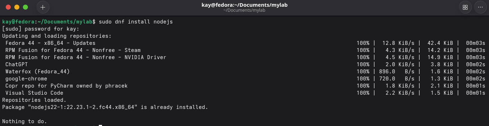
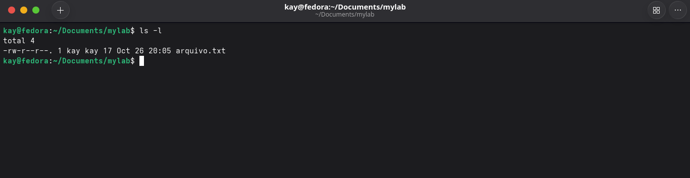
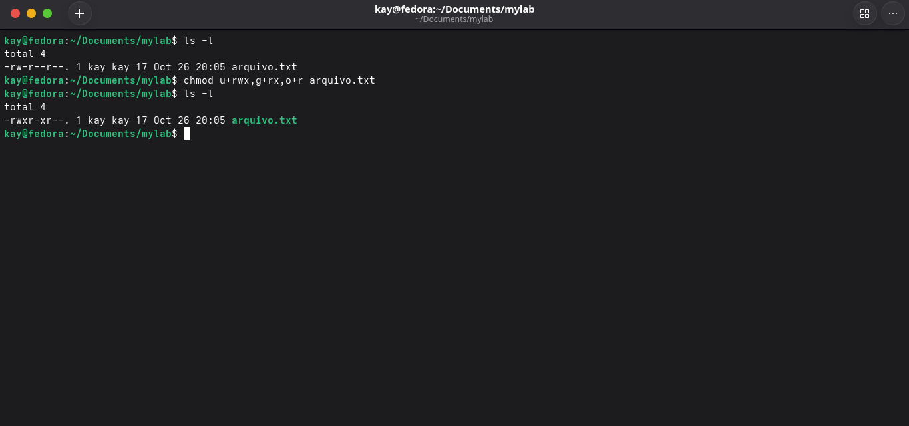
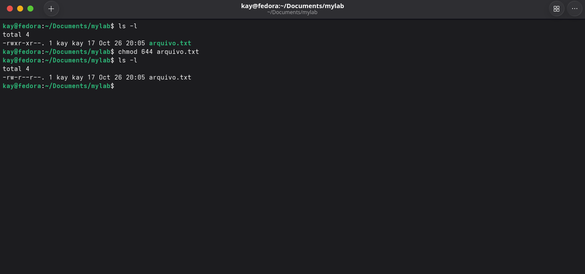
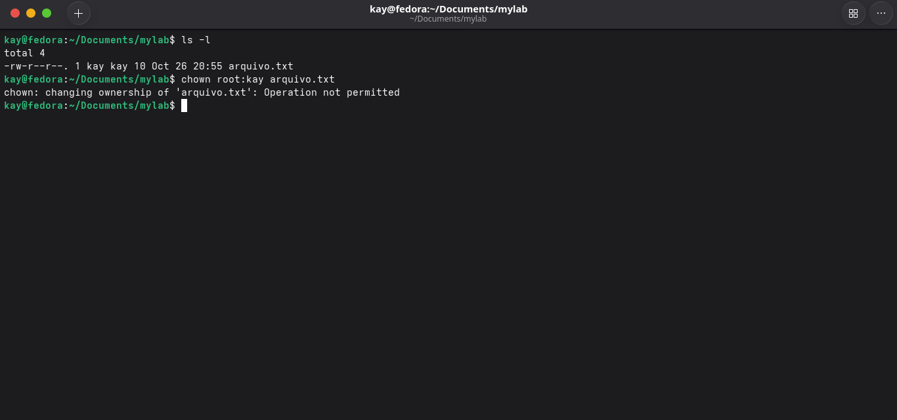
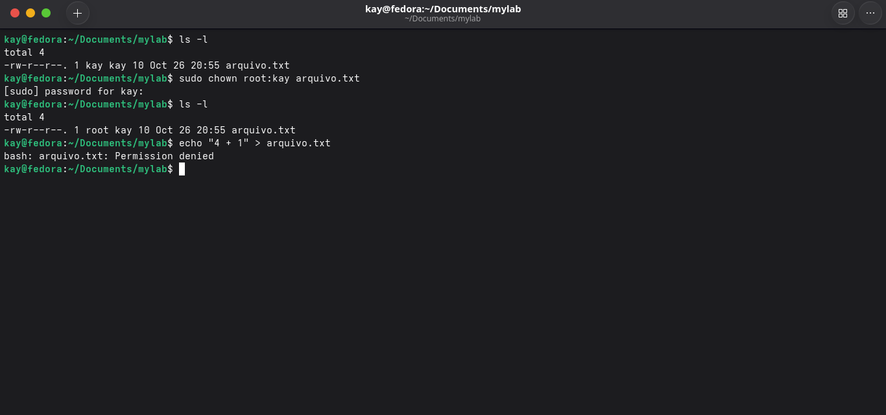
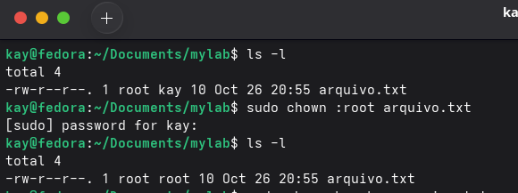

# Permissões e Admin

### `sudo`

- **`sudo` é um comando utilizado para executar outros comandos com privilégios administrativos.**

Útil para situações que exigem permissões elevadas, como instalar aplicativos ou alterar arquivos do sistema.

Exemplo (usando Fedora):

`sudo dnf install nodejs`



### `chmod`

- **Com o `chmod` (Change Mode), você pode conceder ou revogar permissões de arquivos e diretórios no Linux. As permissões controlam o que cada tipo de usuário (dono, grupo e outros) pode fazer com determinado arquivo ou diretório: ler, escrever ou executá-lo.**

No Linux, cada arquivo ou diretório tem três categorias de usuário:

1. **Usuário (owner):** proprietário do arquivo
2. **Grupo (group):** grupo de usuários ao qual o arquivo pertence
3. **Outros (others):** todos os demais usuários

As permissões são representadas por três letras:

- `r`: permissão de leitura (Read)
- `w`: permissão de escrita (Write)
- `x`: permissão de execução (Execute)

Usando `ls -l` é possível verificar as permissões de um arquivo:



O `chmod` pode ser utilizado de duas formas principais: notação simbólica ou notação numérica.

## 1. Notação Simbólica

A notação simbólica usa letras para representar categorias e operações:

- `u`: usuário (owner)
- `g`: grupo
- `o`: outros
- `a`: todos (user, group, others)

Exemplo:



## 2. Notação Numérica

Na notação numérica, cada permissão é representada por um número:

- `r` = 4
- `w` = 2
- `x` = 1

Somando os valores: `4+2+1 = 7` → todas as permissões ativas.

Exemplo:



### Referência rápida — permissões mais comuns

| Valor | Representação | Uso típico |
|---|---|---|
| `777` | `rwxrwxrwx` | Todos podem tudo — evite, é inseguro |
| `755` | `rwxr-xr-x` | Dono faz tudo; os demais só leem e executam. Padrão para pastas e scripts |
| `644` | `rw-r--r--` | Dono lê e escreve; os demais só leem. Padrão para arquivos comuns |
| `600` | `rw-------` | Apenas o dono lê e escreve. Obrigatório para chaves SSH privadas |
| `700` | `rwx------` | Apenas o dono acessa. Usado para pastas `~/.ssh` |

### `chown`

- **`chown` (change owner) altera o dono ou o grupo de um arquivo ou diretório.**

Formato:

`chown [opções] dono[:grupo] alvo`

Exemplo:



No exemplo acima, utilizei o `chown` sem `sudo` para demonstrar que o comando exige privilégios elevados.



Após definir o `root` como único com permissão de escrita na pasta, o usuário comum tem a permissão negada ao tentar fazer alterações, pois sua permissão está definida apenas como `read`.

Também é possível alterar apenas o grupo, colocando `:` antes do nome do grupo:



### Dica — `sudo` com redirecionador `>`

Um erro comum é tentar redirecionar a saída de um comando para um arquivo protegido usando `sudo`:

```bash
sudo echo "texto" > /etc/arquivo  # ❌ Permission denied
```

O problema é que o `sudo` eleva apenas o `echo`, mas o redirecionador `>` é executado pelo shell do usuário, sem privilégios. A solução é passar tudo para um subshell com `sudo`:

```bash
sudo sh -c "echo 'texto' > /etc/arquivo"  # ✅
```
### Criação de Usuários com