# Processos

### `ps aux`

De forma simples, o `ps aux` funciona como um gerenciador de tarefas (assim como no Windows): mostra os processos em execução no momento do comando. É como o `htop`, porém em versão estática.

`ps` significa process status. O `aux` são três opções combinadas:

- `a`: processos de todos os usuários
- `u`: formato detalhado (usuário, CPU e memória)
- `x`: inclui processos sem terminal (serviços em segundo plano)

As principais colunas são: **USER** (dono), **PID** (número do processo), **%CPU**, **%MEM** e **COMMAND** (o programa).

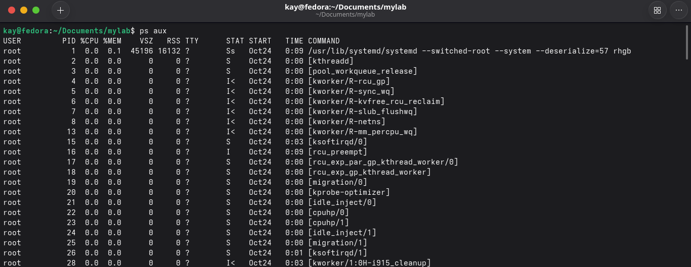

É possível filtrar processos específicos usando o `grep`:

`ps aux | grep /usr/bin/waterfox`

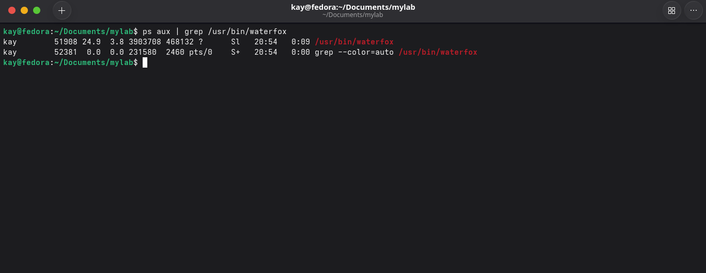

### `htop`

O `htop` funciona como um gerenciador de tarefas interativo para o Linux. Ao contrário do `ps aux`, ele atualiza os processos em tempo real, permitindo ordenar, filtrar e encerrá-los.

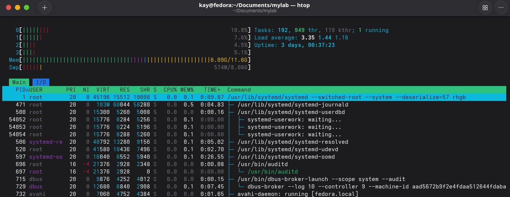

### `kill`

O `kill` encerra processos pelo número de identificação (PID).

Formato:

`kill PID`

O PID aparece na segunda coluna da saída do `ps aux`. Para praticar de forma segura, crie um processo inofensivo com `sleep 300 &`, localize o PID com `ps aux` e encerre-o com `kill`.

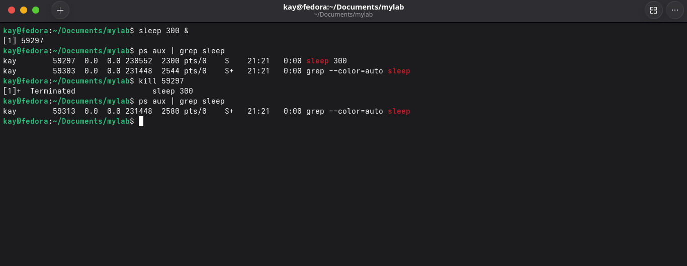

### `systemctl`

O `systemctl` é o principal comando para gerenciar serviços, unidades e alvos do systemd.

#### O que é o systemd?

O systemd é o inicializador do sistema. É o processo que sobe logo após o kernel, responsável por iniciar os serviços, montar o sistema de arquivos e outras funções essenciais.

Dentro desse ecossistema, o `systemctl` gerencia atividades como:

- Iniciar, parar, reiniciar ou recarregar serviços
- Ativar ou desativar unidades para que iniciem junto com o sistema
- Verificar o status dos serviços

#### Ver o estado

`systemctl status nginx`

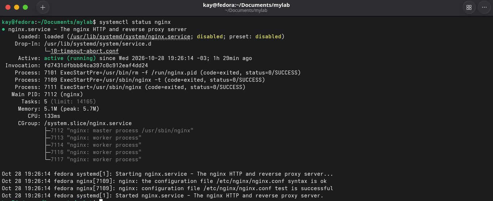

#### Ligar e desligar

`systemctl start nginx`

`systemctl stop nginx`

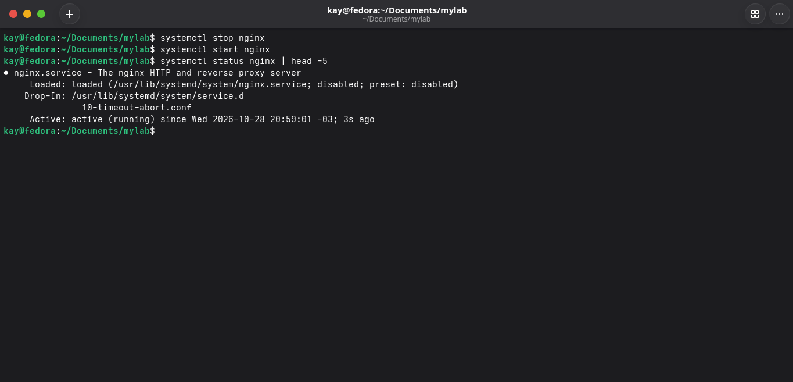

#### Reiniciar (derruba as conexões)

`systemctl restart nginx`

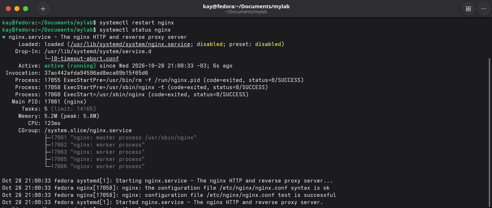

#### Recarregar (sem derrubar as conexões)

`systemctl reload nginx`

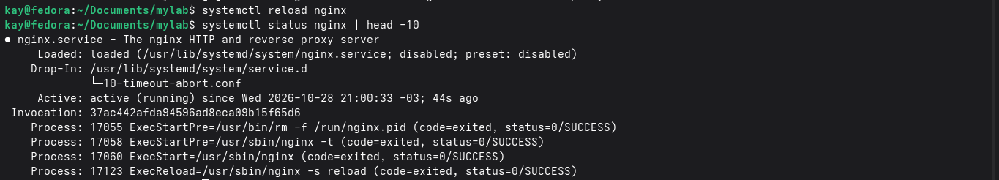

#### Ativar ou desativar no boot

`systemctl enable nginx`

`systemctl disable nginx`

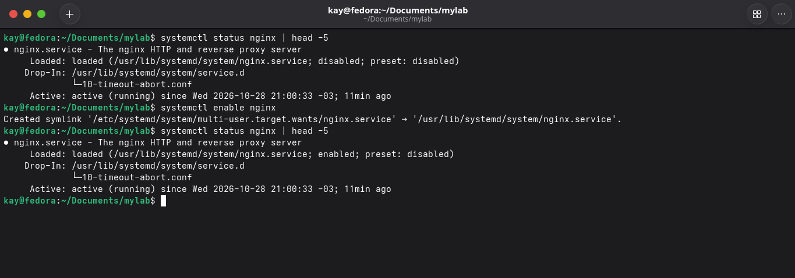

#### Verificações rápidas

`systemctl is-active nginx`

`systemctl is-enabled nginx`

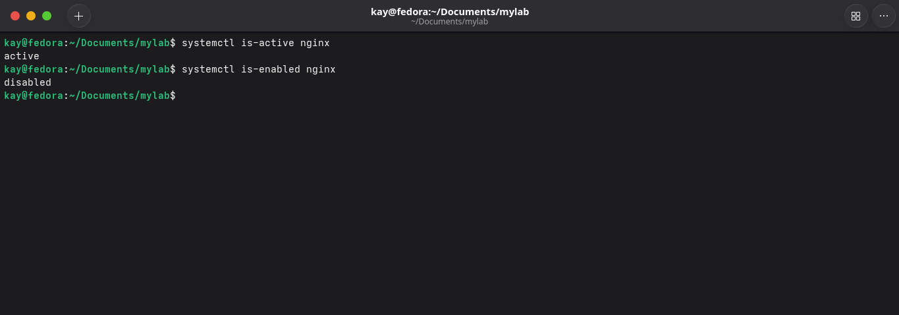

#### Visão geral dos serviços

`systemctl list-units --type=service`

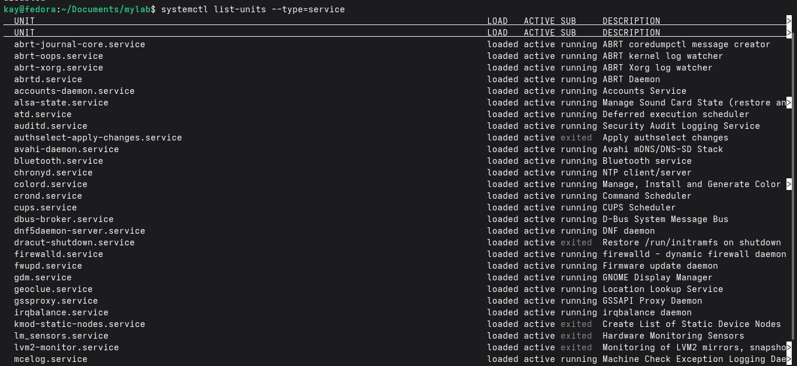

`systemctl --failed`

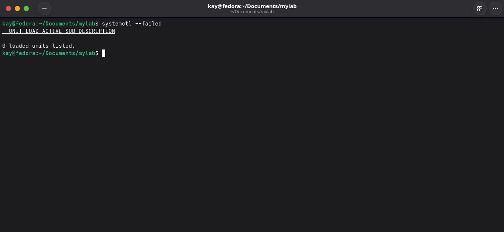

O serviço **nginx** foi usado como exemplo para os testes práticos com `systemctl`.
