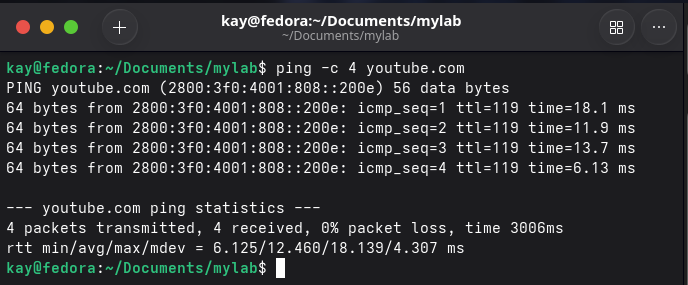
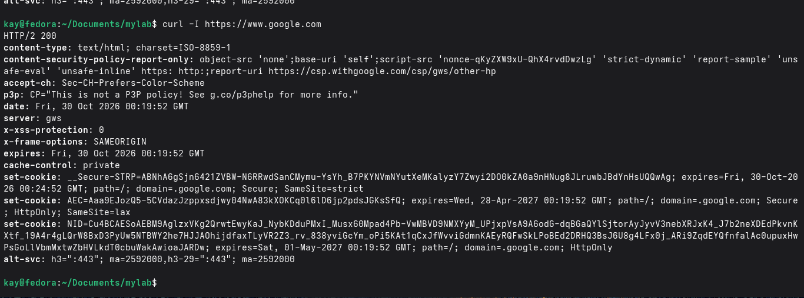
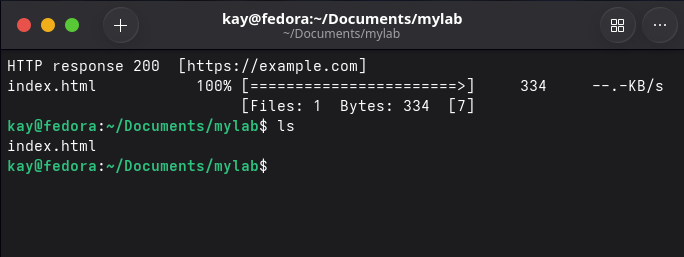
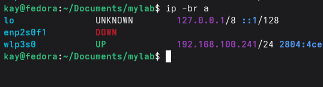
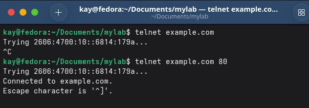
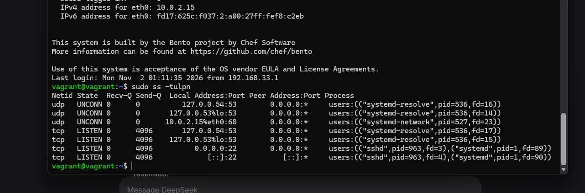
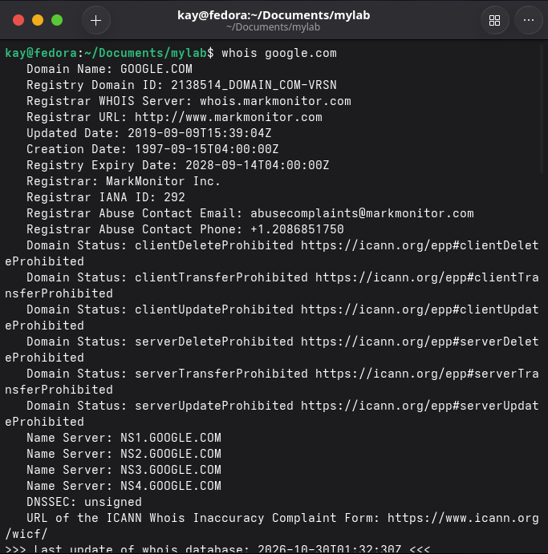
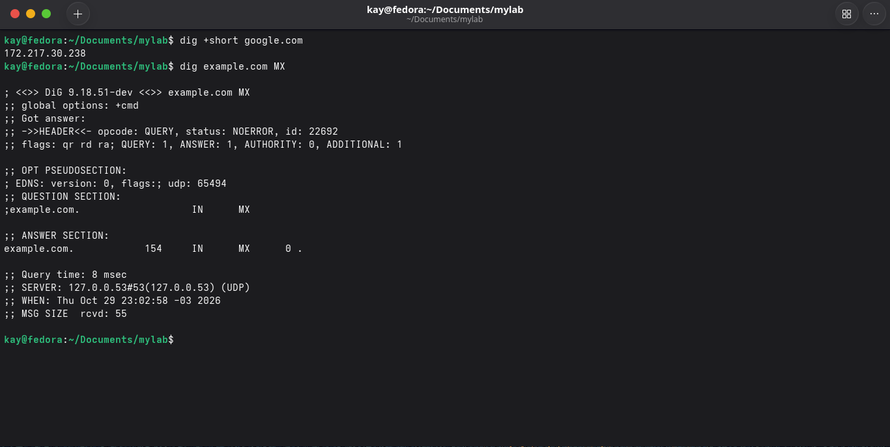

# Redes

## `ping`

O `ping` verifica se um host está disponível e mede o tempo de resposta.

Sintaxe básica:

`ping youtube.com`

É importante definir uma contagem de pacotes, caso contrário o comando ficará rodando até você pressionar `Ctrl+C`:

`ping -c 4 youtube.com`



Informações da saída do comando:

- `packet loss: 0%` → sem perda de pacotes
- `min/avg/max` → melhor, média e pior tempo de resposta
- `mdev` → variação do RTT; quanto menor, mais estável a conexão
- `icmp_seq` → número sequencial do pacote
- `ttl` → limite de saltos (roteadores) que o pacote pode atravessar, evitando loops
- `time` → RTT daquele pacote específico

#### O que é RTT?

RTT (Round-Trip Time) é o tempo que o pacote leva para ir ao destino e voltar.

Em síntese, o `ping` é um comando útil para testar conectividade, verificar disponibilidade de hosts e identificar lentidão ou instabilidade na rede.

## `curl`

O `curl` faz requisições HTTP/HTTPS e testa se um serviço está respondendo, diferentemente do `ping`, que apenas verifica conectividade.

Exemplo básico:



#### Status HTTP

A primeira informação importante na saída é o código de status da resposta. As classes são:

| Classe | Categoria        | Significado                          |
|--------|------------------|--------------------------------------|
| 1xx    | Informativo      | O cliente deve continuar             |
| 2xx    | Sucesso          | Tudo certo                           |
| 3xx    | Redirecionamento | Procure em outro endereço            |
| 4xx    | Erro do cliente  | O problema está no pedido do cliente |
| 5xx    | Erro do servidor | O problema está no servidor          |

## `wget`

O `wget` é um utilitário de download para o Linux. Ele baixa arquivos via HTTPS, HTTP e FTP.

Exemplo de uso simples:



O resultado **200** indica sucesso. Após o download, use `ls` para confirmar que o arquivo está na pasta.

## `ip a`

O `ip a` exibe as interfaces de rede e os endereços IP da máquina. É o primeiro comando a usar para verificar se a máquina está conectada e qual é o seu IP.



## `telnet`

O `telnet` testa se uma porta específica está aberta em um servidor.

Sintaxe:

`telnet domínio-exemplo.com 80`

O número ao final é a porta a ser testada.



## `ss`

O `ss` (Socket Statistics) mostra quais portas estão abertas na máquina e qual processo está por trás de cada uma. É o substituto moderno do `netstat`.

```bash
sudo ss -tulpn
```

O que cada flag faz:

| Flag | Significado |
|---|---|
| `-t` | Mostra sockets TCP |
| `-u` | Mostra sockets UDP |
| `-l` | Apenas portas em estado listening (aguardando conexões) |
| `-p` | Mostra o processo dono de cada porta (requer `sudo`) |
| `-n` | Exibe números em vez de nomes (`:22` em vez de `:ssh`) |



Lendo a saída:

- `0.0.0.0:22` + `sshd` → SSH escutando em **todas as interfaces** — acessível de fora da máquina
- `127.0.0.1:53` + `systemd-resolve` → DNS local escutando **só no loopback** — não acessível de fora
- `[::]:22` → mesma porta 22, mas para conexões **IPv6**

A diferença entre `0.0.0.0` (aceita conexões de qualquer lugar) e `127.0.0.1` (apenas da própria máquina) é a informação mais importante da saída.

Para filtrar uma porta específica:

```bash
sudo ss -tulpn | grep 22
```

## `whois`

O `whois` consulta o responsável por um domínio ou bloco de IP.

`whois google.com`

`whois 163.250.0.0`



## `dig`

O `dig` consulta servidores DNS e retorna os registros de um nome, como o IP (A), os servidores de e-mail (MX) e os servidores de nome (NS).

Complementa o `whois`: o `dig` mostra **para onde o nome aponta**, enquanto o `whois` mostra **quem é o dono**.

`dig +short example.com`

Principais usos:

`dig +short google.com` ← IP do domínio

`dig example.com MX` ← servidores de e-mail

`dig example.com NS` ← servidores de nome

`dig -x 8.8.8.8` ← DNS reverso: retorna o nome associado ao IP


