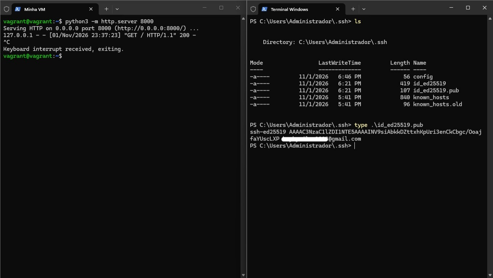
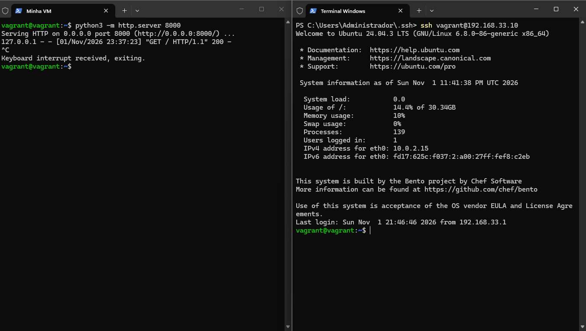
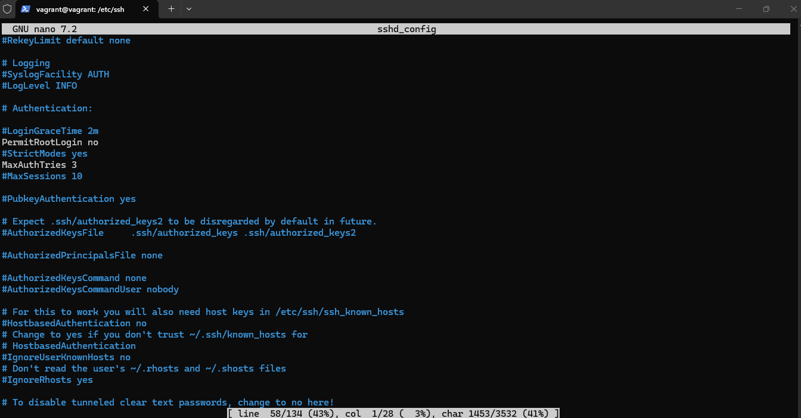
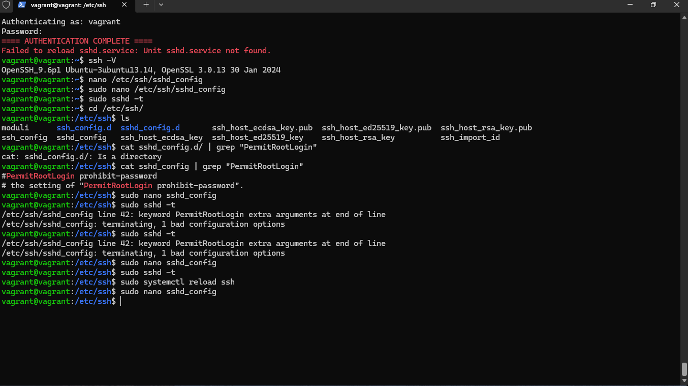
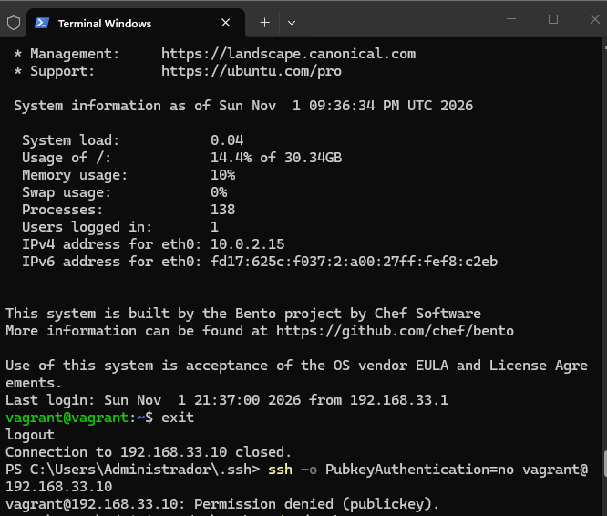
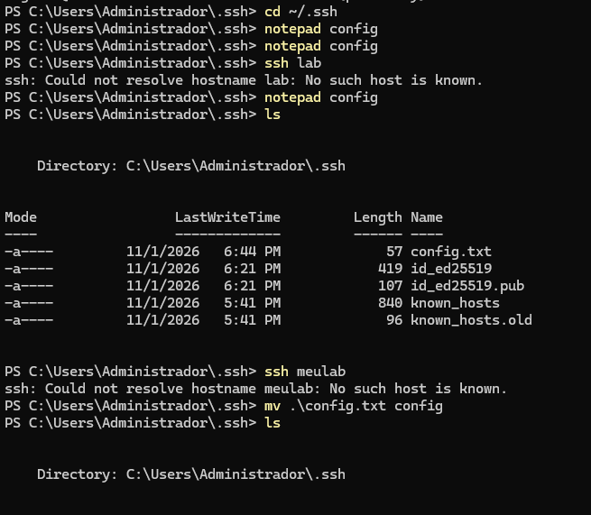
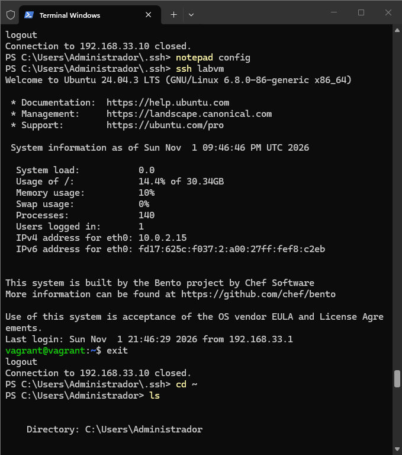
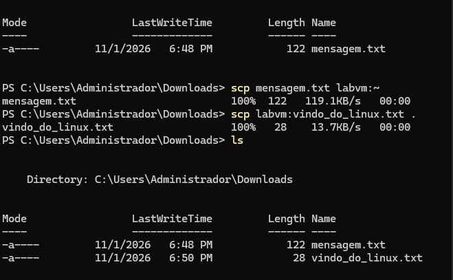
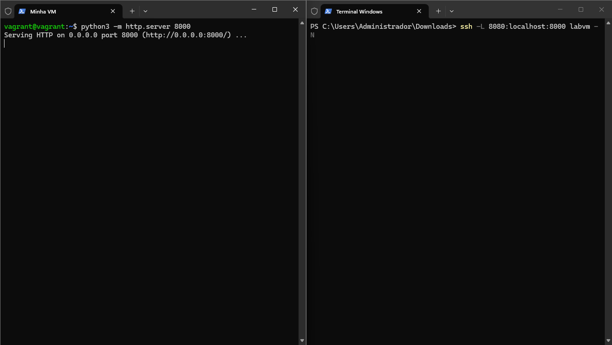
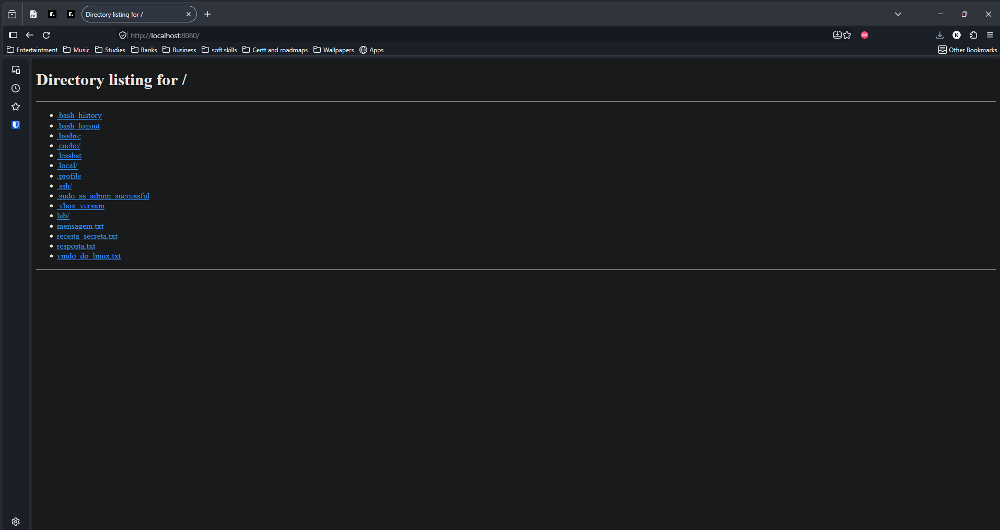

# SSH e Acessos Linux

## O que é SSH?

O SSH (Secure Shell) é um protocolo que permite acessar o terminal de uma máquina remota de forma criptografada. Não é uma interface gráfica — é acesso direto à linha de comando de outro sistema.

A porta padrão do SSH é a **22**.

## Conectar em uma máquina remota

### `ssh`

Formato básico:

`ssh usuario@ip`

Para conectar em uma porta diferente da padrão:

`ssh -p 2222 usuario@ip`

## Gerar e usar chaves SSH

A autenticação por senha é vulnerável a ataques de força bruta. O método recomendado é usar um par de chaves criptográficas:

- **Chave privada:** fica na sua máquina. Nunca compartilhe.
- **Chave pública:** é copiada para o servidor. Fica em `~/.ssh/authorized_keys`.

### `ssh-keygen`

Gera o par de chaves:

```bash
ssh-keygen -t ed25519 -C "nome" <- atribuir é opcional
```

As chaves são salvas em `~/.ssh/`:
- `id_ed25519` → chave privada (`chmod 600` obrigatório)
- `id_ed25519.pub` → chave pública

No Windows, use `type` para ver o conteúdo da chave pública antes de copiá-la para o servidor:

```powershell
type .\id_ed25519.pub
```



### Instalar a chave pública no servidor

Dentro do servidor, prepare a pasta e cole o conteúdo da chave pública:

```bash
mkdir -p ~/.ssh
chmod 700 ~/.ssh
nano ~/.ssh/authorized_keys   # cola o conteúdo de id_ed25519.pub aqui
chmod 600 ~/.ssh/authorized_keys
```

### `ssh-copy-id`

Alternativa automática ao processo manual acima:

```bash
ssh-copy-id usuario@ip
```

Após instalar a chave, o `ssh` conecta direto sem pedir senha:



## Hardening — blindagem do servidor SSH

Após configurar as chaves, é hora de fechar as brechas de segurança no servidor. Todas as configurações ficam em `/etc/ssh/sshd_config`.

### Diretivas recomendadas

| Diretiva | Valor | Objetivo |
|---|---|---|
| `PermitRootLogin` | `no` | Impede login direto como root |
| `PasswordAuthentication` | `no` | Desabilita login por senha, forçando o uso de chaves |
| `MaxAuthTries` | `3` | Limita tentativas por conexão, mitigando força bruta |

Edite o arquivo:

```bash
sudo nano /etc/ssh/sshd_config
```



> ⚠️ **Atenção no Ubuntu:** o arquivo `/etc/ssh/sshd_config.d/50-cloud-init.conf` pode sobrescrever as configurações do `sshd_config`. Verifique e edite esse arquivo também se necessário.

> ⚠️ **Atenção com o `PermitRootLogin`:** o valor correto é apenas `no`. Colocar `PermitRootLogin no comentario` ou qualquer texto extra na mesma linha causa erro de sintaxe.

### Validar e aplicar

Sempre teste a sintaxe antes de reiniciar para evitar travar o acesso ao servidor:

```bash
sudo sshd -t
```

Se não retornar nenhum erro, aplique:

```bash
sudo systemctl reload ssh
```

> ℹ️ Use `reload` em vez de `restart` para aplicar as configurações sem derrubar as conexões ativas. O `systemctl restart sshd` pode falhar no Ubuntu — o serviço correto é `ssh`, não `sshd`.

O print abaixo mostra o processo completo: edição, validação com `sshd -t`, a pegadinha do argumento extra no `PermitRootLogin` e o `reload` final:



### Confirmar que o login por senha foi bloqueado

```bash
ssh -o PubkeyAuthentication=no usuario@ip
# Resultado esperado: Permission denied (publickey)
```




## Configurar atalhos de conexão

### `~/.ssh/config`

Crie uma "agenda" de servidores para não precisar digitar IP e usuário toda vez.

Arquivo: `~/.ssh/config` (no Linux/macOS) ou `C:\Users\SeuUsuario\.ssh\config` (no Windows)

```
Host labvm
    HostName 192.168.33.10
    User vagrant
```

Com isso, basta digitar:

```bash
ssh labvm
```

> ⚠️ **No Windows:** o Bloco de Notas salva como `config.txt` por padrão. Renomeie para `config` sem extensão usando `mv .\config.txt config` no PowerShell.



Após renomear corretamente, o `ssh labvm` conecta direto:



## Copiar arquivos via SSH

### `scp`

O `scp` (Secure Copy) copia arquivos usando o túnel seguro do SSH.

Enviar um arquivo do computador local para o servidor:

```bash
scp arquivo.txt labvm:~
```

Puxar um arquivo do servidor para a pasta atual:

```bash
scp labvm:arquivo.txt .
```



## Túnel SSH (Port Forwarding)

Permite acessar serviços que estão rodando dentro do servidor diretamente na sua máquina local.

**Cenário:** servidor web rodando na porta `8000` dentro da VM, acessível na porta `8080` do computador local.

Dentro da VM, suba o serviço:

```bash
python3 -m http.server 8000
```

No computador local, crie o túnel:

```bash
ssh -L 8080:localhost:8000 labvm -N
```

- `-L`: encaminhamento local
- `8080`: porta no computador local
- `localhost:8000`: destino dentro da VM
- `-N`: não abre shell, apenas mantém o túnel



Acesse `http://localhost:8080` no navegador para ver os arquivos da VM:


